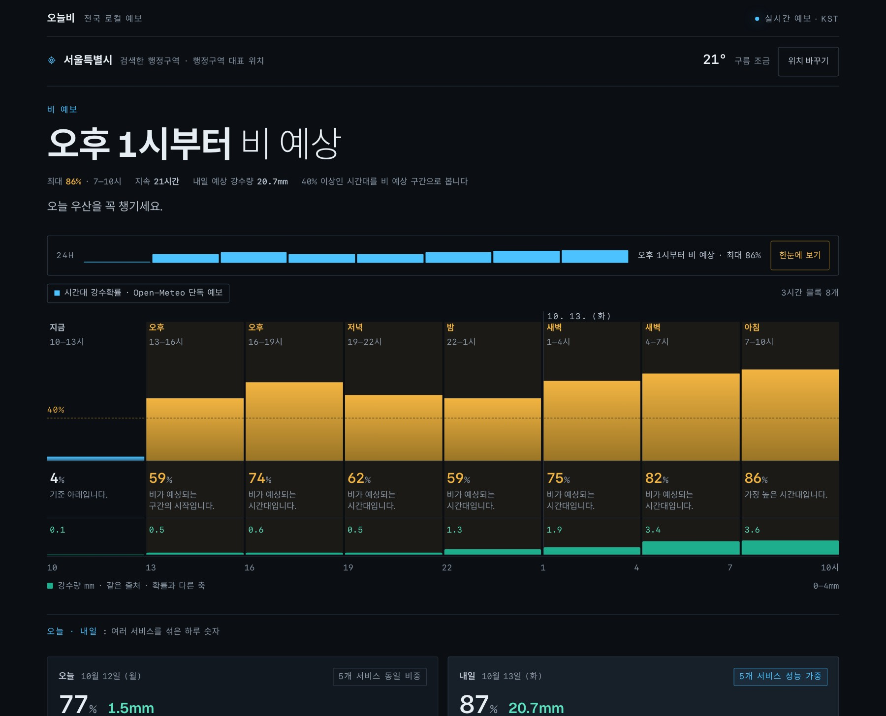

# 오늘비 · Raintoday

Rain forecasts for South Korea, with the evidence behind tomorrow’s forecast.

**[Live app](https://raintoday.vercel.app)** · [How forecasts are evaluated](https://raintoday.vercel.app/behind-the-data)

Check rain probability and amount, compare five weather providers, and inspect the station evidence behind tomorrow’s blend. The interface is Korean; choose 서울, 부산, 제주 or 강릉 to try it without sharing device location.



Historical production capture from October 13, 2026; this is not current weather.

## Engineering decisions

- Serving and capture use the same provider adapters. The hourly timeline takes one named provider’s next 24 hours; daily comparisons combine available providers.
- Immutable forecasts captured before outcomes are scored against KMA ASOS observations. Evidence can adjust tomorrow’s blend only under sample and benchmark gates; insufficient or unavailable evidence falls back to equal influence. Hourly captures are for evaluation and do not feed the served timeline.
- Service-area validation happens before provider requests. Missing values stay missing. Device coordinates are used for forecasts, not stored in the performance database; browser location storage uses reduced precision.

Next.js · React · TypeScript · Tailwind CSS · PostgreSQL / Postgres.js · GitHub Actions · Vercel

## Run locally

Use Node 24.15+ within the 24.x line and npm.

```bash
npm ci
install -m 600 .env.example .env.local
npm run dev
```

Open-Meteo provides a keyless baseline. Configure Kakao for search and optional provider keys in [.env.example](.env.example). [Operations](docs/OPERATIONS.md) covers evidence collection and database setup; [verification](docs/VERIFYING.md) covers checks and disposable database contracts.

## Scope

Provider availability and horizons vary. Station observations may differ from conditions at the selected location, and the weighting policy does not establish an overall accuracy advantage. Weather information is not suitable for safety-critical decisions.

The site uses Vercel Analytics, Speed Insights and Sentry error reporting; shared-link location data is removed from reported URLs. See the [forecast contract](docs/FORECAST_CONTRACT.md) and [provider contracts](docs/weather-sources.md) for data boundaries.

Maintained for correctness, security, compatibility and operations. [Decisions](docs/DECISIONS.md) · [Roadmap](docs/ROADMAP.md) · [Releases](https://github.com/mhju0/raintoday/releases)

## License

Copyright © 2026 Michael Ju. All rights reserved. Public for portfolio review; no license is granted to use, copy, modify, or distribute the code.
